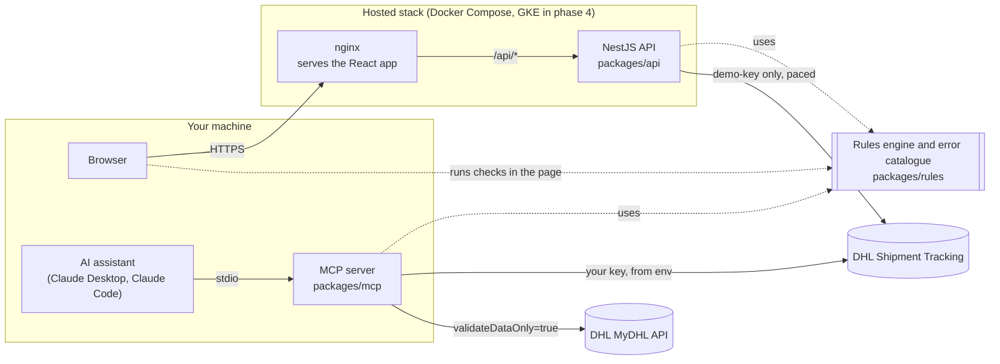

# Integration Doctor for DHL APIs

Checks a DHL API request before you send it, and explains DHL's error responses in plain
language, with a link to where each explanation comes from.

> Not affiliated with, endorsed by, or sponsored by DHL or Deutsche Post DHL Group. "DHL" is
> their trademark and is used here only to say which APIs this tool works with.


## Why

Integrating DHL's APIs fails in a handful of ways, again and again, with terse answers:

- a key from the wrong app, which Shipment Tracking answers with `401 Unauthorized for given resource`;
- MyDHL's own date format, where an ISO 8601 date gets `998: ShipTimeStamp is not well formatted`;
- a 46-character address line, answered with `Parameters not having correct format: cityName (maxLength=45)`;
- a weekend pickup date, answered with `996: The requested product(s) not available for the requested pickup date`.

Each of these is documented somewhere, in DHL's API specifications, its support articles, or an
integrator's help centre, but rarely next to the error. This tool puts them together.

## Architecture



One rules engine, three ways in. Checks that may involve a key run where the key already is: in
your browser, or in the MCP server on your machine. The hosted API only ever calls DHL with DHL's
public demo-key.

## The rules engine (phase 1)

`packages/rules` is a TypeScript library with no runtime dependencies. It runs in Node and in
the browser.

- **`diagnose(request)`**: 47 kinds of check across Shipment Tracking – Unified, Location Finder,
  MyDHL API and Parcel DE Shipping:
  - the host, environment and endpoint, against every operation in DHL's OpenAPI specifications;
  - the authentication scheme each API expects;
  - query parameters and the JSON body;
  - MyDHL `POST /shipments` fields (required, types, lengths, enums, unknown keys), validated
    against a subset of the 3.4.0 schema and reported in DHL's own validator wording;
  - business rules the schema cannot express: the shipping date window, export declarations for
    dutiable shipments, US domestic routes, pickup times.
- **`explain(response)`**: reads DHL's error formats (RFC 7807 problem documents for the unified
  APIs, MyDHL's coded details and validator messages with JSON pointers) and matches them against
  a catalogue of 29 known errors, each with causes, fixes and sources.

```ts
import { diagnose, explain } from '@integration-doctor/rules';

diagnose({
  method: 'GET',
  url: 'https://api-eu.dhl.com/track/shipments?trackingNumber=00340434292135100186',
  headers: { Authorization: 'Bearer abc' },
}).findings[0].title;
// 'No DHL-API-Key header'

explain({ status: 400, body: '{"detail":"998: ShipTimeStamp is not well formatted. …"}' }).matches[0].fixes;
// ['Send local time with the offset after "GMT": 2026-10-27T10:00:00GMT+08:00.']
```

### Design choices

- **Rules first, no AI in the core.** Every finding comes from a fixed rule with a cited source.
  A language model may later explain findings, but never decides them.
- **Sources are labelled.** DHL's own documentation is marked official; integrators' help
  centres and public issues are marked as community evidence.
- **Nothing calls DHL.** The checks work without a DHL account, which matters because MyDHL API
  credentials are only issued to DHL Express customers.

## The web app and API (phase 2)

- **`packages/web`**: React 19 and Vite. Paste a request (or a curl command) to check it, or paste
  DHL's error response to have it explained. Both run **in your browser**, so a key in a pasted
  request never leaves the page. A third tab makes a live call to DHL with DHL's public
  `demo-key` through the API. A pasted curl command is read the way bash would read it,
  including Chrome's "Copy as cURL" output for bash and for Windows cmd.
- **`packages/api`**: NestJS 12. The same checks over HTTP for scripts and CI
  (`POST /api/diagnose`, `POST /api/explain`, `GET /api/catalogue`), the live probe
  (`POST /api/probe/tracking`), a health check, and OpenAPI docs at `/api/docs`.
  - The probe only ever sends `demo-key` and rejects any other field, because DHL's terms don't
    allow sharing API keys with a third party. Live checks with your own key happen in the
    MCP server, which runs on your machine.
  - Calls to DHL are paced to the demo-key's published limits (one per 5 seconds, 250 a day,
    reset at 00:00 GMT) and are never cached. Each client may make 20 probe calls an hour, so
    one script cannot spend everyone's daily quota. The pacing lives in the API process, so it
    holds for a single instance; more replicas need a shared counter.
  - Behind nginx the API trusts exactly one proxy hop (`TRUST_PROXY_HOPS`), and nginx replaces
    `X-Forwarded-For` rather than appending to it, so clients cannot pick their own rate-limit key.
  - Request validation (class-validator, unknown fields rejected), helmet headers, per-client
    rate limiting, and no logging of request bodies.
- **Containers**: multi-stage images on `node:24-alpine` and `nginx-unprivileged`, running as
  non-root, read-only, with all capabilities dropped; Compose publishes the app on localhost
  only. nginx sets a strict Content Security Policy for the app.

## The MCP server (phase 3)

`packages/mcp` lets an AI assistant (Claude Desktop, Claude Code, or any MCP client) use the same
checks while it helps you build or debug a DHL integration. It runs on your machine over stdio.

| Tool | Does | Calls DHL |
|---|---|---|
| `diagnose_request` | Checks a request before it is sent | No |
| `explain_error` | Explains an error DHL returned, with causes, fixes and sources | No |
| `search_known_errors` | Looks up the error catalogue by code, words or API | No |
| `track_shipment` | Shipment Tracking with your key, or DHL's demo-key | Yes, read-only |
| `validate_mydhl_shipment` | MyDHL `POST /shipments` with `validateDataOnly=true`: DHL validates, creates nothing | Yes, only if MyDHL credentials are set |

The catalogue is also a resource, `integration-doctor://catalogue`.

- **Keys stay on your machine.** Credentials come only from the server's environment; no tool
  takes one as input, so they never enter the conversation. Results show where a key came from
  (`<your key from DHL_API_KEY, ending 9876>`), never the key.
- **Nothing is created at DHL.** Tracking only reads, and the MyDHL tool always sends
  `validateDataOnly=true`. Live calls are paced to DHL's published limits.
- **Rules decide, the assistant explains.** The server's instructions tell the assistant to quote
  findings and their sources, and to say so when it adds its own reading.

```bash
npm run build
node packages/mcp/dist/src/index.js --help
```

An assistant asking `explain_error` about a MyDHL 996 gets:

```text
API: MyDHL API
DHL said: "996: The requested product(s) not available for the requested pickup date."
Error codes: 996
Known errors that match:
996: Product not available on the pickup date (id mydhl.996)
   The product cannot be picked up on plannedShippingDateAndTime.
   Likely causes: The date is a weekend or a public holiday. | The time is after the pickup cut-off for that location.
   Fixes: Move the date to the next working day, or ask GET /products what is available on that date.
```

Claude Code: `claude mcp add integration-doctor -e DHL_API_KEY=<your key> -- node <repo>/packages/mcp/dist/src/index.js`.
Claude Desktop, in `claude_desktop_config.json`:

```json
{
  "mcpServers": {
    "integration-doctor": {
      "command": "node",
      "args": ["<repo>/packages/mcp/dist/src/index.js"],
      "env": { "DHL_API_KEY": "<optional: your Shipment Tracking key>" }
    }
  }
}
```

## Development

```bash
npm install
npm test               # Vitest: rules, API, web and MCP server tests
npm run lint           # ESLint, strict type-checked
npm run typecheck
npm run build

# Local development: API on :3000, web on :5173 (proxies /api)
npm run start -w @integration-doctor/api   # after npm run build
npm run dev -w @integration-doctor/web

# The full stack in Docker on http://localhost:8080
npm run stack:up
npm run stack:down

# Re-record docs/demo.gif (needs the stack running and ffmpeg; makes one demo-key call)
npm run demo:record

# End-to-end tests: builds the stack with a stand-in for DHL, runs Playwright, tears it down
npx playwright install chromium
npm run e2e
```

The end-to-end suite never calls DHL: `compose.e2e.yaml` points the API at
`e2e/dhl-stub.mjs`, so tests don't spend the shared demo-key quota.

## Roadmap

- [x] Rules engine and error catalogue
- [x] NestJS API and React web app, with Playwright tests
- [x] MCP server, so an AI assistant can run the same checks with your own key, locally
- [x] Demo and architecture diagram
- [ ] Deployment to Google Kubernetes Engine with Terraform, and CI/CD with GitHub Actions
- [ ] Optional AI explanations in the web app, grounded in DHL's documentation; rules still decide every finding

## Licence

MIT, see [LICENSE](LICENSE). The licence covers this code only: DHL's names, API specifications and
documentation belong to DHL, and the error catalogue quotes them briefly, with links, to explain
their errors.
